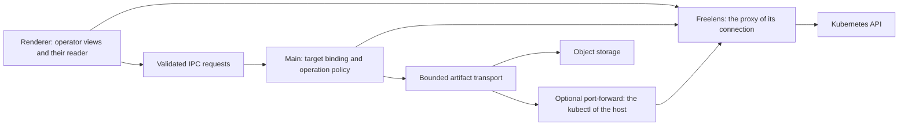

# Architecture

Date: 2026-10-29

Status: the foundation is complete and the first views are in place: the discovery of
the installation, the Backups, the Restores, the Schedules and the storage and
snapshot locations, read only; the gate of the writes, with the way between the
processes; the request for an artifact, with its transport and its route; and the
tabs that show an artifact in the workspace of a backup and of a restore, proven by
their unit and component tests and by a suite in the packaged application on the
real backup and the real restore of the test environment. Since T0.7 the extension
runs on the extension API of Freelens v2
([SPEC-0015](../specs/SPEC-0015-freelens-v2-host.md)), and what follows describes
it there. The actions are not implemented: their sections below are the design
their specs start from.

Authority: [directives](../../AGENTS.md), [roadmap](ROADMAP.md), and
[versioned evidence](RECON-T0.1.md). The evidence report pins Velero v1.18.4 and the
AWS plugin v1.14.4; the Freelens validation target is the one of SPEC-0015, the
release Freelens 2.0.0, built from freelensapp/freelens `b9b53e16`, its tag v2.0.0. A
reviewed version is not a compatibility claim for untested releases. Product
behavior below requires spec approval.

## Boundaries

The extension runs inside Freelens; it adds no server, relay workload, or dashboard
to an operator's cluster. Velero and its storage plugin already run there.

| Area | Owns | Must not own |
| --- | --- | --- |
| Renderer | Native lists, dedicated operation workspace, navigation, forms, local presentation state | Kubeconfig/credentials, signed URLs, direct network downloads, write authorization |
| Common | Typed DTOs, runtime-validation contracts, pure phase/progress/reference helpers | Electron/React side effects, sockets, file access, unscoped global state |
| Main | Target resolution, create-only operations, write policy, request ownership, artifacts, cancellation, transport, the kubectl of a tunnel | Arbitrary renderer-supplied URLs, kubeconfig paths, raw manifests, cluster fallbacks, or a client, a kubeconfig or a credential of its own |

Use the React 19, MobX 7 and extension APIs the host provides, one copy of each,
and the build conventions of the template of the organization,
freelensapp/freelens-example-extension, the reference template of the extension
API. Select
additional dependency versions explicitly and lock them. Prefer established
libraries for runtime validation, windowing and cron parsing; reach the cluster
through the host and through nothing of the extension's own. Do not introduce a
new application framework or a parallel state-management system.

### The Build And The Checks

The manifest, the toolchain and the build are the ones of the template of the
organization since T0.7 (D6 of SPEC-0015): `engines.freelens` is `^2.0.0`, which
Freelens 1 lists as Incompatible before any code runs; the package is an ES
module, `"type": "module"`, with its entries `dist/main.js` and
`dist/renderer.js` and `files` `dist/**/*`; `@freelensapp/extensions` is pinned
exactly to the version of the validation target, 2.0.0 since the release of
Freelens 2.0.0, until the range of versions D10 of SPEC-0015 gives it in M6.
Biome, Knip and Trunk run through `pnpm dlx` at the exact versions the scripts
name, as in the other extensions.
Activation asks nothing of a cluster, in either process. Both open the store of the
preferences; the main process registers its procedures on an instance of
`Main.Ipc` made for the activation, and the renderer registers the pages of the
Overview, of the Backups, of the Restores, of the Schedules, of the Backup Storage
Locations, of the Volume Snapshot Locations, of the Backup Repositories, of the Pod
Volume Backups and of the Pod Volume Restores, their entries of the sidebar, the
sections it adds to the details the host shows of each of the eight kinds, made with
`detailsFor`, and the eight kinds as `customResources`, which the Custom Resources
tree of the cluster leaves out while the extension is enabled. Every page and
section is drawn inside an
[error boundary](../../src/renderer/components/error-boundary.tsx) of the template,
since the host has none around its drawer of the details. The main entry also
exports its diagnostic modules, for the build test and the transport proof.

`pnpm build` is two runs of Vite 8, in library mode, as ESM: the renderer for the
browser, with nothing external, where an import of a module of Node or of Electron
fails the build; the main process for Node, with the modules of Node and
`electron` external.
The [plugin of the modules of the host](../../build/vite-plugin-host-modules.mjs)
replaces a bare import of React, its DOM, its JSX runtime, MobX or the bindings of
MobX for React with a module that reads it from `globalThis.FreelensExtensionApi`,
where the host publishes them; the main process takes MobX alone from it. The shim
of the SDK is bundled. The build writes exactly one stylesheet, `dist/renderer.css`, which the
host links next to the renderer entry: the views import their CSS module for its
class names only and inject no style. There is one build form, the one that is
packed.

There is one program of TypeScript for each process, main and renderer, each with
the code of common, one for the tests, one for the tooling, one for the integration
test and the suites, one for the scripts of the test environment, which Node runs
by stripping their types, and the three of the environment tests of the template,
which fail when a type of Node reaches the renderer or common, or one of the DOM
reaches main or common: nine, which `pnpm type:check` runs and the build does not.
A lint rule refuses `act`, `react-dom/test-utils`, Testing Library and Vitest in
code that is not a test.

The unit and component tests run on the [stub of the SDK](../../test/freelens-extensions.ts)
of the template, grown as the tests need, and on the
[doubles of the components of the host](../../test/host-components.tsx), written
from the source of the host at the commit of the validation target, each naming
the file and the line it follows, with Testing Library 16 on React 19. The
canonical unit command builds first, so that the [build test](../../test/build.test.ts)
reads the files the build wrote and loads both bundles: `dist/main.js` under Node
with a stand-in of the API of the host, the renderer bundle through the module
runner of Vitest, with the stub as the API of the host. The unit tests do not
substitute for the installation into a real Freelens. The scripts chain their
steps explicitly: the selected pnpm configuration runs no implicit pre and post
hooks. Knip development checks the source dependencies; its production pass reads
the sources of each bundle and counts `dependencies` alone, which is why the one
library the renderer bundles, react-window, is declared there. pnpm 12 runs with
strict peer dependencies, so that a library shared with the host outside the peer
range of the SDK fails the install.

The hosted checks are the ones of the other extensions of the organization, on
every pull request and on main: the build, the type check, lint and Knip; Trunk;
the unit tests; the integration tests, FND-10 and a session for each of the five
kinds of the template's integration test, which install the packed build in a
Freelens built from source at the commit of the validation target, on a disposable
kind cluster of the scripts of this repository; the end-to-end tests, which bring
the test environment up on the runner, run the fixtures and the transport proof
and take it down; the tests of the views, which run every suite, the pre-review
and FND-10 in a Freelens built from source at the same commit against the fixtures
of that environment, the build cached by the commit and not by a version, as the
integration tests cache it; OSV-Scanner; and, on a pull request that changes
`.nvmrc`, `mise.toml` or `mise.lock`, the check of `mise.lock`. They run on
synthetic data only. Renovate and the daily maintenance workflows of the
organization (npm audit, npm dedupe, Biome migrate, Trunk upgrade) open their pull
requests on branches named `automated/*`. A release is three workflows: the version
workflow opens the pull request that sets the version, the tag workflow tags main
when that pull request is merged, a version `X.Y.Z` or a prerelease `X.Y.Z-N`, and
the release workflow builds the bundle from the tag, publishes it to npm, on `next`
for a version with a hyphen and on `latest` otherwise, and attaches the tarball,
its checksums and its software bill of materials to the GitHub release, marked as
a prerelease for a version with a hyphen.

### Dependencies

The graph carries no override and no patch. What is bundled, what only builds, and
the history of the overrides of the first weeks are in
[DEPENDENCY-AUDIT.md](DEPENDENCY-AUDIT.md).

Since T0.7 the bundles carry one library, react-window 2.3.4, the version of the
catalog of the host, in the renderer, for the lines of a log and the rows of the
resources viewer (D8 of SPEC-0015).
The main bundle carries none: the client of Kubernetes, `ws` and the stub of undici
of T0.6 went with the client of the extension, since the main process reaches the
API server through the client of the host and forwards a port with the kubectl of
the host. The unit run of the head of T0.7, on 2026-10-17, is 83 files and 2,588
tests, on the stub of the SDK of v2 and on the doubles written from the source of
the host at the validation target; the measures of the code of a log and of the
adherence of a schedule run after them, alone. The integration test covers the
installation in the host, the suites of the views what the views do in it.

### Lessons Adopted From The Other Extensions

- CRD enumeration can itself be forbidden. A failed CRD list is not evidence that
  Velero is absent; support explicitly configured namespaces and truthful RBAC states.
- Forwarding helpers with a permissive fallback and cleanup do not belong in a
  multi-cluster recovery tool. Fail closed on target resolution and own every
  socket, timeout, cancellation, and partial failure.
- A promise timeout does not necessarily abort network I/O. Download deadlines must
  terminate the request, decompression, polling, and any tunnel they own.
- A signed URL points to object storage, not to a Velero HTTP service. No separate
  Velero service endpoint or extraction of S3 credentials is needed for downloads.

## Target And State Model

- Installation identity is the pair of catalog cluster ID and Velero namespace.
  Object identity adds API version, kind, name, and UID. A name alone is never a key.
- Every request has an opaque request ID and a selection generation. Main binds it
  to the IPC sender, resolved cluster identity, namespace, operation, and object UID.
- Cluster or installation changes clear pending confirmations, disable write mode,
  and cancel owned diagnostic work. Ignore late results from older selections.
  Cancelling a UI wait does not undo a Kubernetes operation already submitted.
- Recreated objects with the same name are different targets. Refetch UID and
  relevant resourceVersion immediately before submission; a changed object requires
  a fresh review. Never silently switch to another backup or installation.
- Cache resource metadata only in memory, scoped to installation. Keep stale values
  visible with their last-success time during refresh; never relabel a failed refresh
  as a successful read. Drop cached data on session disposal or authorization loss.
- Persist only explicit non-secret preferences in the host's local extension store:
  namespace selection, filters, column layout, and approved connection settings.
  Diagnostic payloads, signed URLs, operation confirmations, and write enablement
  are not persisted. No telemetry or remote logging is added.

## Kubernetes Access

### Reads And Discovery

Read through the client of the host, `KubeJsonApi.forCluster` of the cluster, whose
answer gives its status whatever it is. Model classes expose static metadata and
typed spec/status; derive behavior with pure helpers rather than extension-specific
instance methods.

Opening Velero inspects only the selected cluster. CRD/API discovery establishes
API availability, not that a controller is healthy. A permitted BSL list suggests
installation namespaces; configured namespaces support restricted RBAC and incomplete
installs. Do not scan every catalog cluster or hard-code `velero` as the only choice.

| Evidence | Result |
| --- | --- |
| Successful authoritative discovery with no Velero APIs | Not installed |
| Some expected APIs absent | Incomplete API installation; identify affected views |
| List succeeds with zero objects | Empty result in the queried scope |
| Discovery/list is forbidden | Access restricted, not absent or empty |
| BSL list is empty or unavailable | Installation namespace may still be configured |
| Generic host error with no reliable status | Unknown/error, never guessed 403 or 404 |

If precise API discovery/status codes need the main process, use its adapter, the
client of the host for the cluster of the request, with the same target contract
below, and document the path; do not parse English error strings. Do not create SelfSubjectAccessReview, diagnostic requests, or other API
objects merely to render read-only views. A not-yet-tested write permission is
unknown, not granted; the actual API decision is authoritative.

### The Reads Of The First Views

The views read through the connection of the host to the cluster they are shown
for, and through nothing else. The [reader](../../src/renderer/api/reader.ts) asks
the client of the host for the cluster of its frame,
`Renderer.K8sApi.KubeJsonApi.forCluster(<cluster>).getResponse`, which gives the
answer whatever its status, as a structural answer of the host and not a `Response`
of the DOM: the states of the table above come from its status, never from the text
of an error. It sends `GET` and no other verb, to the paths of the kinds of Velero
alone, creates no `KubeApi` and registers nothing with the host, and it is the only
place of the renderer that reaches the cluster. On v2 the reads leave from the frame
of the cluster, through Chromium, to the origin of the frame, and the host's proxy
takes them to the API server, where the guard of the suites counts them. Of an
answer it reads the status, the text and the header Date, and nothing else: since
the first pull request of T3.3 an answer carries the time the header says it was
written at, half a second after the second the header names, beside the clock of
this machine in the middle of the request, or neither when the header is missing or
is not a date written as HTTP writes one. The answer is of the origin of the frame,
so the header can be read, and it is the one of the API server: the proxy of the main
process of the host takes the read to the freelens-k8s-proxy of the cluster on the
fetch path of http-proxy-3, over HTTP/2
([the route](https://github.com/freelensapp/freelens/blob/b9b53e16056578c5407312eba5823a089972f6d5/packages/core/src/main/freelens-proxy/freelens-proxy.ts#L475-L534),
[the target](https://github.com/freelensapp/freelens/blob/b9b53e16056578c5407312eba5823a089972f6d5/packages/core/src/main/cluster/freelens-k8s-proxy-target.ts#L152-L166)),
and each of the two proxies keeps the header of the answer it passes on, as AGENTS.md
says with the lines of their source.

| Read | When | Path |
| --- | --- | --- |
| What the API serves | A view opens, or the operator reads again | `/apis/velero.io/v1` |
| Where the installations may be | The same | The backup storage locations of the cluster |
| The six families read at every read: the five of the first milestones and the backup repositories | A namespace is selected, every 15 seconds while a view is open, or the operator reads again | The lists of the selected namespace |
| The pod volume backups, the pod volume restores | At once when a view that shows them first needs them, then with every read while one holds them | The lists of the selected namespace |

Facts of the host the design rests on, found by asking the packaged application on
Freelens 1 and proven again on v2, by the packaged suites or in the source of the
host at the validation target:

- An object of the API has no `selfLink` any more, and the host asks for one to
  build an object of a list
  ([the check](https://github.com/freelensapp/freelens/blob/b9b53e16056578c5407312eba5823a089972f6d5/packages/kube-object/src/kube-object.ts#L115-L120)).
  The [store of the list](../../src/renderer/state/list-store.ts) adds it to the copy
  it gives to the host, and the lists of the suites mount their rows with it.
- The host writes the store of an extension from its main process, and passes the
  changes between its windows. The [store of the preferences](../../src/common/preferences-store.ts)
  is opened in both processes, in `onActivate`: opened in the renderer alone, what
  the operator chose was never written. On v2 the suite of the preferences proves
  it, and the host saves the file once for one change.
- The host writes the file of a store key by key, from what the store gives it, and
  removes no key: one the store stops giving keeps in the file what it held
  ([the save](https://github.com/freelensapp/freelens/blob/b9b53e16056578c5407312eba5823a089972f6d5/packages/core/src/features/persistent-storage/main/persist-state-to-config.injectable.ts#L16-L22)).
  A key that may become empty is always given, empty.
- The search of the lists of the host waits 250 ms after the last key before it
  gives the list what was typed
  ([the wait](https://github.com/freelensapp/freelens/blob/b9b53e16056578c5407312eba5823a089972f6d5/packages/core/src/renderer/components/input/search-input-url.tsx#L41)).

The reader builds no `KubeApi` of its own: one that an extension creates registers
itself with the host, and on v2 the reader has the client of the host instead.

The [state of an installation](../../src/renderer/state/installation.ts) is one for
each frame, which is the frame of one cluster, and is created when the first view
opens. Every change of the selected namespace makes a new generation, empties what
was read and leaves the answers of the generation before where they arrive: an
answer is taken only if the generation it was asked for is still the current one,
and only the objects of the namespace that was asked are kept of it. The host lists
are given a store that selects nothing and removes nothing, with
`subscribeStores` off: the extension reads, the host draws.

The state also holds two values of the installation it reads, for the adherence of
its schedules ([SPEC-0013](../specs/SPEC-0013-schedule-adherence.md)): the offset of
the zone of the Velero server that the schedules and the backups give, taken when
the families of a read were all answered and kept once the backup it was read in is
gone, the very object when nothing changed; and the time of the API server, from
the newest answer of the read that listed what was asked, kept when a read fails.
Both are of the generation: a new one starts with neither, and an answer of the one
before brings neither. What the views share of the adherence for a read and a tick
of their clock is made once for the installation from the reads as they are stored,
the two values and the clock ([the context](../../src/renderer/state/adherence.ts)):
the rows of the list, the band of a schedule and the details of the host ask for it
at every drawing, and nothing of it is computed while the backups were never
answered. The state says as well whether a view of the extension is open, so that the
families are asked again every 15 seconds: the details of the host, which the host
draws where no view of the extension is, compute with the last read of the views,
and say its age when no view is open or when it is older than that period.

The watch of the host is not used for these views. A list every 15 seconds while a
view is open costs six requests, and one more for each family read on demand that a
view holds, shows a failed read as such, with what was read before and when, and
stops when the last view closes. The watch comes with the spec that needs what it
gives.

The families of an installation are one union of eight
([the families](../../src/common/discovery.ts)): six read at every read, and the
pod volume backups and the pod volume restores, read only while a view that shows
them is open ([SPEC-0014](../specs/SPEC-0014-repositories-and-data-movement.md),
REQ-178): an installation may hold thousands of them, and a view that does not show
them does not pay for them. What a view needs of those is said by a holder, in one
call that replaces what it needed before, and the call answers the function that
lets it go. The frame of a page is a holder: it needs what its page and the view
that is open over it read of the families on demand, since the list stays under the
view, and calls again when the view changes, so that a view that changes from one
kind to another never lets go of a family both need. A family needed and never read
is asked at once, alone, in the generation, through the same guarded read; then at
every read while it is held. A family no holder needs is not asked at the read after
it was let go, and what was read of it goes then: a view opened again within a read
finds it still read, and no timer is added. A new generation keeps the holders and
empties the reads, and an answer of a family no holder needs any more is not taken.
The Overview, the lists of the other kinds and the views of a backup, a restore, a
schedule and a repository hold none; the sections of the details of the host hold
none and ask nothing.

What is [known of a family](../../src/common/read-state.ts) is what the last read
that ended said of it. A family that is asked again keeps that, and is marked as
being read: a list that was denied is not an empty one for the time of a read, a
reference does not lose its target, and what was read is not of an earlier read
until a read fails. Only a family that was never answered is loading. The
installation gives what it read of a family with the type of the objects of that
family, in one place: the views do not give it one of their own.

### The Counters The Release Does Not Write

The reviewed release writes no counter of zero, and counts the errors and the
warnings of an operation when its work ends. The [phase](../../src/common/phases.ts)
of an operation says, beside where the operation is and what it says of a
failure, where its work is and whether the release gives that phase only after
it counted. A counter that is missing from an object of such a phase is read by
the [evidence](../../src/common/evidence.ts) as a count of none, and kept apart
from a zero that is written; in every other phase it is not reported, and the
[words](../../src/common/operation-text.ts) of the views say why. A failed
operation is not among the counted ones: the release can fail one before it
counts. The facts are in the
[recon](RECON-T0.1.md#start-of-the-second-milestone-2026-09-28), and the reading
is a [deviation](../specs/SPEC-0003-backup-read-only.md#evidence-and-deviations)
from the design of the states, approved at the review of the second milestone.

### The Lists And The Views Of One Object

Every kind has the same two things: a list, which is the native list of the host,
and the view of one object, which is of the extension. They are written once. A
[page](../../src/renderer/components/family-page.tsx) is given the
[definition](../../src/renderer/pages/restores-page.tsx) of its list, which is its
columns, its order, what its search looks into and what a row shows; the
[store](../../src/renderer/state/list-store.ts) the host asks the rows of answers
from what the installation read of the family. A
[frame](../../src/renderer/components/workspace.tsx) gives every view its name, its
way back and Escape, which a text field of the view keeps for itself: there the key
clears what was typed, and a view is never left from inside a field. The
confirmation of a request keeps it as well: there the key leaves the confirmation,
and the frame does not hear it. The layout
around a page is the one of the host, which gives every page of the group the tabs
of the group: the entries of the lists are registered before the entry of the group,
which is how the host knows a page of a group, and no page has a layout of the host
of its own.

What is around a page is written once as well. The
[frame of a page](../../src/renderer/components/views-frame.tsx) has the target
bar, what is missing of the installation, the view that is open over what the
page shows, and the focus given back to what the view was opened from. The page
of a list and the Overview are what is inside it.

The views that are open are in the address of the page, as the values of one
parameter, `view`, each one the kind and the name of an object: `backup/nightly`,
then `restore/restore-of-nightly`. The last one is shown. What the address names
is decided by [pure functions](../../src/common/views.ts); the
[navigation](../../src/renderer/navigation.ts) gives the address what they
decided, once:

| Rule | Reason |
| --- | --- |
| The namespace is not in the address | It is the one of the installation selected: an address cannot name an object of another |
| A view opened from another one is added after it, and the way back takes it away | The way back leads where the operator came from, and says where in words |
| A view that is already on the way is gone back to, not added again | From a backup to its restore and to the backup again is not a way of three |
| The way keeps its last eight views | An address has an end |
| What is not the name of a view opens none | The address is text that anyone can write |
| One change of the address for one change of what is shown | The list behind would be drawn for a state no one asked for |

A view opened from another one is shown on the same page, over the same list: the
page does not change when a backup leads to its restore. The list stays mounted
behind the views, hidden and not removed, so that every way back ends on the list
as it was left, with its search, its order, its widths and its scroll, and with the
focus on the row the first view was opened from. A link from the details of the
host opens the page of the kind with the view in its address. The views that are
open are of the installation they were opened in: they close when another one is
selected.

A reference to an object is a way to its view only when the object was found and
its kind has a view: a reference to a kind that has none yet is a name with what
is known of its target. The kinds that have a view are the ones of the
[list](../../src/common/views.ts) the address is checked against. What each of
them needs of the renderer is beside what uses it: its
[page](../../src/renderer/navigation.ts), its
[component](../../src/renderer/pages/open-view.tsx) and the
[references](../../src/renderer/components/workspace.tsx) that lead to it. Since
T5.1 they are eight: the five of the first milestones, `backup-repository`,
`pod-volume-backup` and `pod-volume-restore`, and a reference to a backup
repository, a pod volume backup or a pod volume restore that is found leads to its
view as the others do. Each view reads the families it shows, and the notices over
it are of those alone, as decided while implementing, on 2026-10-26: a backup, a
restore and a schedule the backups, the restores, the schedules and the two
locations; a repository the repositories and the storage locations, the operations
that use it coming with the band that shows them; an operation its own family,
which the frame holds, the family of its owner, the storage locations and the
repositories. The pod and the node of an operation are the links of the host to their
details (`LinkToPod`, `LinkToNode`), which read nothing and leave the host to read
the object when its drawer opens.

### The Time Of An Operation And The History Of A Schedule

The [time of an operation](../../src/common/operation-time.ts) is its start time
when the object reports one and its creation time when it does not. The reviewed
release writes the start time when the validation of an operation passes: a backup
that failed its validation has none, and neither has one that waits. What orders
the operations, and what places them on a line of time, goes by the time of the
operation and says which of the two it is. Ordered by their start alone, the
backups of a schedule that all fail their validation would come after every backup
that started: the newest backup of the schedule would be an old one that
completed, and the failure would not be seen. That an operation did not start is
said by its phase: one with no start time in a phase of the work has a start that
is not reported.

The [history](../../src/common/schedule-history.ts) of a schedule is the backups
of its namespace that carry its name in the label Velero writes on them, from the
newest. It is what the cluster holds now: a backup that expired or was deleted is
not in it. Its counts are of those backups. A history whose backups were not read
is not known, which is not an empty one. The backups of a read are put in order by
their schedule once for the read: a list asks for the history of each of its rows
every time it is drawn.

The line of time is computed by a [pure function](../../src/common/operation-line.ts)
from the operations, the clock and the width it is drawn in: each operation at
its time between the beginning of the line and now, and one mark for the ones
that would be drawn over each other, which says how many they are and whether
one of them failed. The line of a history begins at its oldest backup; the one
of the Overview at the beginning of its window, and has no operation before it.
A mark is as wide as the gap between two marks lets it be, whatever it holds:
its number is written in three characters at most, the thousands from a
thousand on, and how many operations it holds is in its words, with the five
newest of them. A failure is a shape beside the mark, and not its colour
alone. Two marks are as far from each other as
a mark is wide, at least. The line ends at the newest backup when the clock of
the cluster is ahead of the one that draws it. The width is measured where the
line is drawn, when it is drawn. Nothing is drawn between two backups: what a schedule should have done is the
adherence of the fourth milestone, which needs the time zone of the server and
what the controller skips. The [grammar and the computation of the expected
run](../../src/common/schedule-adherence.ts) are pure functions beside the history,
with the clock as an argument: the parser of the reviewed release written from its
rules, the next instant in the zone of the expression, read through Intl and never
from the desktop, the anchor the controller counts from, the expected run and the
bounded count of the runs that passed, and the backup of the last submission among
the backups that exist; the list, the view of a schedule and the details of the host
show them since the first pull request of T3.3, and the Overview with the second.
The [signal of a schedule](../../src/common/schedule-signal.ts) is
computed from them and from what was read of the installation, with the clock as
an argument, the pause and the phase read before anything of the expression: the
state of the schedule, awaited, due, overdue, held, at every look, not known, no
run or paused, with its mark, its weight in the order of a list and its words,
written once for every view; the offset of the zone of the server, read in the
name of the backup of the newest submission of the installation and kept by the
state of the installation as a plain value given back with each read, so that it
stays known once that backup expires; the backup that holds the submissions; the
last observed run; and the clocks of this machine and of the cluster.

### The Locations And What Uses Them

What the views show of a [location](../../src/common/location-view.ts) is one
reading of the object. Availability, access mode and default are three facts, each
read from its own field: the phase, the access mode of the spec and the mark of
the spec. Nothing but a reported Available is available: a location that reports
nothing, and one that reports what this version does not know, have the mark of
what is not known. The phase of a volume snapshot location has that mark whatever
it says: the reviewed release neither writes nor checks it.

What a storage location reports is as old as its last validation, and a server
that stopped leaves every availability as it was. The views say how old the
validation is and, past a bound, that the availability may be out of date: three
times the frequency the location names, or one hour when it names none or turned
the validation off. The two bounds are two constants, and the clock is an
argument. The [durations](../../src/common/go-duration.ts) are read from the form
the API writes them in; one that cannot be read is shown as written.

Where a location points is shown as the object carries it. A value that reads as
a URL is shown without its user information and its query, and the view says
that it left them out, and so is an address that the message of Velero quotes. A
Secret is a name and the name of a key: the views read none, and the reader asks
the host for no path that is not written as one of the kinds of Velero.

[What uses a location](../../src/common/location-users.ts) is the backups that
name it and the schedules whose template names it, in its namespace, from the
reads of the installation. The location of a backup is the one the view of the
backup leads to: the one of its spec, or the one of the label the release writes.
The location marked default has beside them the schedules that name none. What
was not read is not known, which is not none.

A view says what is missing of the families it reads, which its kind
[names](../../src/common/views.ts): the view of a location shows nothing of the
restores, and what is denied of them is not said over it.

### The Overview

The [Overview](../../src/renderer/pages/overview-page.tsx) asks the cluster
nothing of its own. It is computed from five of the six families read at every
read of the installation, the backup repositories apart, by
[pure functions](../../src/common/overview.ts) that are given the reads, the
clock and the window: what was read, what needs attention, what is in flight, the
newest backup that completed, the operations of the window, a line for each
schedule and for each storage location. What was read of a family is what every
view reads of it, with what the cluster says that it serves.

What needs attention is the items of eleven rules, each a function of what was
read. Rule A11, the adherence of a schedule, reads the
[signal of a schedule](../../src/common/schedule-signal.ts) computed with what the
views share of the adherence of the installation for a read and a tick of their
clock, which is made of the same reads, and gives no item while the backups of the
installation were never answered. An item is of one rule and of one object, or of
the list of a kind when it is of no single object, with its reason in words and
the time the reason refers to. A rule gives items from the families that were read
and from no other: a family that was not read gives one line, which says what the
rules did not look at. After those lines one says of how many schedules the
adherence is not known, by reason, and leads to their list: such a schedule is
never an item of A11, and the summary says the count as well, so that a page with
no item does not read as one where every schedule is on time. The order is fixed:
what is in flight, the storage, the schedules, what ended; each group from the
newest, and by name where there is no time. No function computes a value for the
installation as a whole, and the page has none.

The [window](../../src/common/window.ts) of the recent operations is a
preference of the extension, kept in the store beside the two maps of the
namespaces. It is one of three values, and seven days when the store holds none
or holds what is not one of them. Choosing one asks nothing of the cluster. The
store is one for every cluster, and each cluster has its frame: what a frame
keeps is changed from what the store holds at that moment, and what another
frame kept is taken at every read.

The views of the operations are built once for a read and a clock, and the
backups of a schedule are found in an index made once for a read: what needs
attention, what is in flight and the recent operations are made from the same
ones, and the newest completed backup is looked for of the ten schedules that
have a line. The signal of every schedule is computed once for a drawing, for rule
A11 and the count of what is not known, and again for the ten that have a line,
which show their next run and their adherence as the list does.

A band shows ten items, and the ones after them when they are asked for: an
installation of a thousand operations is not drawn whole to say what is first.
What was asked of a band stays shown when the installation is read again, and
the page stays where it was scrolled.

### The Tabs Of An Operation

The workspace of a backup and the one of a restore show one of five things: the
summary, or one of the four artifacts Velero wrote of the operation into its
storage, the log, the results, the resource list and the volume information. The
[strip](../../src/renderer/components/workspace-tabs.tsx) is the `Tabs` and the
`Tab` of the host, with what they lack for a list of tabs: the role of the list,
whether a tab is selected, the panel it shows, and the arrows, Home and End. The
tab that is open is a second parameter of the address, `tab`, beside the views.
The host changes the address once for each parameter it is asked to set, and a
view would be drawn between the two at the tab of another: the
[navigation](../../src/renderer/navigation.ts) writes the views and the tab into
one search and sends the host there once, and not at all when nothing changes,
since the host, sent to the address it is at, goes there and comes back. The tab
is of the view that is shown: the summary is no tab in the address, and a view
that becomes the one shown is at its summary.

What the tabs loaded is held by the
[installation](../../src/renderer/state/installation.ts), as the
[loads](../../src/renderer/state/artifact-loads.ts) of the view that is shown: one
[load](../../src/renderer/state/artifact-load.ts) for each tab, made when the tab
first asks for it, four at most. A load is at one of six states: nothing asked;
the confirmation asked of the main process; the confirmation shown, with its
token; the request running, with the step the main process is at; the text
loaded, with how it came; or ended without it, with the words of the main
process. It is asked in the two gestures of a write, as the version of the server
is. While the request runs the main process is asked for its step every 250
milliseconds; when the run answers, the pages of the text are taken one by one
into the one copy the views hold, and a page that is not the one that was asked,
a page of another count and a text beyond the bound of an artifact are refused.
A step takes an answer only while it is still the step of the tab: what arrives
after the load was dropped, left or begun again is not taken, and what the main
process held for it is let go. A text that is shown stays, under the confirmation
of the next request, until that request is created. The loads are dropped, with
what the main process holds for them, when the view closes, when another view is
shown over it, when the installation changes, and when another object took the
place of the operation under its name; a confirmation that waits is left when
writes go off, and a request that runs is not.

The [panel](../../src/renderer/components/artifact-panel.tsx) of a tab draws where
its load is, each state with its [words](../../src/common/artifact-text.ts): what
the tab would create, with the state of the gate first where writes are not on;
the confirmation of one write, with the object; the step, beside the mark of the
host that moves, with the way to cancel; the text, with when it was loaded and its
size over it, and its two commands, the one that loads it again and the one that
saves it, beside those words or under them, and under the text the request it came
through, the way it came by, what loading again does and until when the text can
be saved; or how the load ended, marked as a fault, as a file the store does not
have or as a cancellation, with the one command that follows it. What Velero signs
no URL for is said from what the installation read, before anything is asked. A
file the store did not have is said by the [phase](../../src/common/phases.ts) the
operation had then. The command that saves asks the main process, which writes the
copy it holds: the panel says until when it holds it. What the panel and the
viewers say in numbers and in names they write as attributes as well, which the
suites read beside the words.

A viewer is given the text of its tab and nothing else of the load. The parsers of
the [log](../../src/common/artifact-log.ts), of the
[results](../../src/common/artifact-results.ts), of the
[resources](../../src/common/artifact-resources.ts) and of the
[volumes](../../src/common/artifact-volumes.ts) are pure functions, read a text
once, and answer nothing for a text that is not of the shape of the release,
which is then shown as its [lines](../../src/renderer/components/artifact-lines.tsx)
under a note. The log keeps the text as it was given and, beside it, two numbers
for each line, where it begins and its level: the lines a filter leaves and the
ones a search finds are found when they are asked for, and a line is made of the
text for a row that is mounted and for no other. The lines are windowed by
react-window 2, which the extension bundles at the version of the catalog of the
host, since v2 offers its virtual list to extensions no more (D8 of SPEC-0015); the
list is given the height of every row and measures none: a row is as tall as the
lines it takes, counted from the characters of the line and the columns of the
room, and a hundred rows are mounted at most. The words a search found are marked
in the rows that are mounted, and take no room. The resources are windowed by
react-window 2 as well, under the head of the tables of the host; the volumes are
a table of the host; the results are headed lists that
show two hundred messages at a time. The view that shows a tab is a column: its
panel takes what the title and the tabs leave of the room of the view, and the
list of lines, or the rows of the resources, take what the panel leaves, between
a least and a most of their own, so that a list is whole in the room it is read
in. Nothing is counted on the window: where the target bar leaves the view less
than the room of a list, the page is scrolled.

The tabs rest on facts of the host, which the
[directives](../../AGENTS.md#host-facts-that-cost-a-run-to-find) record. Its input
leaves the focus at Enter unless it is told not
to, and its search input takes the focus when it is mounted and a shortcut of the
whole window: the fields of the viewers are the input, told to keep the focus. The
panel gives the first line of a text the focus once its row is drawn, and waits for
the row, not for the viewer. The levels of a log and the wrap of its lines are
commands that say whether they are chosen, with `aria-pressed`, drawn as the box of
the checkbox of the host, so that the Tab key reaches each of them.

The [suite of the tabs](../../e2e/__tests__/velero-e2e-artifacts.tests.ts) drives
them in a packaged Freelens, on the real backup and the real restore of the test
environment and on the fixtures of the tabs, and the pre-review opens them in eight
of its views: what each proves is in the
[evidence](../specs/SPEC-0011-artifact-viewers.md#evidence-and-deviations) of
their spec. The fixtures of the tabs are in the installation of the test
environment: two backups its server syncs from files its store is given, and three
operations it refuses. The scripts of the environment place them and remove them,
the backups through the server, as the
[testing strategy](TESTING.md#the-fixtures-of-the-tabs) says.

### Create-Only Adapter Decision

On Freelens v2 the client of the host, `Main.K8sApi.KubeJsonApi.forCluster(clusterId)`,
reaches the API server of a catalog cluster through the proxy of Freelens, which
authenticates as the connection of the host does, credential plugins included, and
applies the proxy setting of the cluster; it posts any object, by path, and its
`getResponse` gives the answer whatever its status. The apply helpers of the
extension API can update existing objects, and are not used.

Product decision (D1 of [SPEC-0015](../specs/SPEC-0015-freelens-v2-host.md#d1-the-api-server-from-the-main-process)):
the create-only adapter of the main process is the client of the host for the
cluster of the request, and nothing else. The extension reads no kubeconfig, runs
no credential plugin, refuses no kind of authentication of its own, and keeps no
client and no connection of its own to an API server. Resolve the cluster from the
catalog of the host in main, by the identifier of the frame, and fail closed when
its entry is not there or is not connected: since freelensapp/freelens `cd07118f`
the proxy of the host answers a request to a cluster that is not connected 503, but an
upgrade, as the port-forward of the tunnel, still starts the proxy of that cluster,
with an authentication the operator did not ask for. Never take a default kubeconfig, an
active or first cluster, or a path from the renderer.

- Create uses a namespaced POST, never apply or PUT. Build allowlisted object types
  from validated operation parameters in main; do not expose a generic CRUD IPC API.
- Preserve API-generated names for DeleteBackupRequest and ServerStatusRequest.
  DownloadRequest uses the verified target-plus-UUID naming contract, with DNS name
  length validation. A name collision must not update the existing resource.
- Track each submission locally. Repeated request IDs rejoin the same in-flight
  operation rather than creating duplicates. Do not blindly retry POST after an
  ambiguous connection loss: report an unknown submission result and reconcile the
  identified request before another user-approved attempt.
- Use read requests to poll the created object. The client of the host has no
  deadline of its own, so the adapter aborts every request through a signal of its
  own; a rejected timeout promise alone is insufficient.
- For CRD patches, request explicit merge/JSON patch semantics. The host's default
  strategic patch is unsuitable. Use resourceVersion or JSON-patch tests for
  conflict-sensitive changes, and never replace the whole object from stale UI state.
- Do not invent login fallbacks, store tokens, log configuration, or send
  credentials across IPC: the connection of the host is the identity, and the
  extension never sees its credential.

The implemented [adapter](../../src/main/diagnostic-kubernetes.ts) asks every
request through `getResponse` of the client of the host, the creations too, so that
every status is read from the answer: a 10-second deadline through a signal of its
own, 4 MiB of an answer counted as its body arrives, header names in lowercase,
which the client merges into its own key by key, no query parameter without a
value, and no upsert. What a call rejects with is read by its shape, the `Status`
body of a read refused with 403, an error the client parsed with its status, or the
error of the fetch when no answer came, and never as an `Error` it is not. Before
every request it reads the entry of the cluster in the catalog of the host, and
refuses one that is not there, not connected, or whose kubeconfig path or context
name changed since writes were turned on, before anything is sent; it reads the
entry again once the cluster answered, and drops the answer of a cluster that
changed meanwhile. It validates exact namespace/name plus UID presence on reads.

A creation that got no answer, from a fetch that failed, the deadline, an answer
that cannot be read or is too large, or a 5xx, is an unknown submission, never an
automatic retry: the extension does not see the connection of the host, and cannot
tell a creation that was not sent from one whose answer was lost. The service
reconciles it by reading the named DownloadRequest, and checks its ownership and
target before reuse. The label of the name of a backup is cut as the release cuts
it.

T0.6 proved certificate authentication, actual generated ServerStatusRequest names
and 409 preservation on local kind, with the client of the extension of that time.
On v2 the transport proof runs the same main code with stand-ins of the host made
from the isolated kubeconfig of the test environment (D9 of SPEC-0015), and the
packaged suites prove what the host adds, its proxy, its catalog and its kubectl:
the creations of a DownloadRequest and of a ServerStatusRequest counted on the API
server, a cluster disconnected with a load in flight left disconnected, and the
binding to the frame that a handler of the main process reads. No private host API
and no default kubeconfig is used.

## IPC, Errors, And Write Policy

All privileged operations require a runtime-validated discriminated request. Accept
cluster ID, namespace, object identity, approved operation parameters, and request
ID; reject unknown fields and malformed or oversized payloads. Authenticate ownership
through the actual IPC sender and deny a request if sender/target binding cannot be
established. A TypeScript interface or a renderer checkbox is not authorization.

Write mode is off by default and session-only, scoped to cluster and installation.
Main enforces it. Every create/patch/delete also needs an operation-specific review
and explicit confirmation containing context and namespace. Diagnostic reads that
create DownloadRequest or ServerStatusRequest use this policy too. Switching target,
disabling writes, expiry, or object changes invalidates pending approvals.

Represent results as typed success or errors with codes such as validation,
not-installed, forbidden, not-found, conflict, cancelled, deadline, submission-unknown,
artifact-missing, transport-unreachable, tls-invalid, destination-denied, and
payload-too-large. Carry stage, retry safety, and safe presentation text separately.
Never forward raw client errors, request/response bodies, headers, paths, or URLs.
An unknown underlying error remains unknown, not a fabricated storage diagnosis.

### The Gate And The Way Between The Processes

The [gate](../../src/main/write-gate.ts) is held by the main process, one for each
cluster: off when the session starts, on for one namespace of the cluster after a
confirmation that names the context of the entry of the catalog and the namespace,
off again when the namespace changes, when the entry of the catalog goes, changes
its kubeconfig path or its context name, or leaves the connected state, when the
frame that turned it on goes, when the operator turns it off, and when the extension
is deactivated. A cluster whose entry is not there or is not connected refuses to
turn writes on, as a target that changed, and an adapter that cannot be made
refuses it with that reason. Every write is confirmed for one exact target with a token bound to the
frame that asked, good for thirty seconds and for one use; a cluster has at most 32
confirmations that wait and 16 writes that run. The renderer shows a mirror of what
the main process answered and decides nothing.

The [procedures](../../src/main/ipc.ts) are the ones of the
[contract](../../src/common/ipc.ts): every request is read by its reader, which
refuses a field the contract does not know, a form it does not give and a request
beyond 64 KiB; every answer is a result, with a code, a stage, whether it is safe to
try again and words that are safe to show; a procedure never raises. The procedures
are a subclass of `Main.Ipc`, made in `onActivate` and reset in `onDeactivate`, and
the event of a handler is typed as the `IpcMainInvokeEvent` of Electron, so that
the compiler checks what is read of it. The sender of a
request is the frame it comes from: its cluster is read from the address of the frame
with the [rule of the host](../../src/common/frame.ts), and its key is that cluster
with the process and the frame identifiers of the frame. The packaged application
writes the address of the frame of a cluster as
`https://<clusterId>.renderer.freelens.app:<port>`, with the port of its proxy,
and the identifier is the first label of the host once the port is taken off, as
the host reads it; in development the host is `<clusterId>.localhost`. A request
that names another cluster, or that comes from the window of the host, is refused. The frame of a write
is checked again at the creation, four times a second while the write runs, and
before its result: a write whose frame went is aborted. The result of a write
is the answer of the call that ran it; its progress is read by the frame that asked,
by the identifier of the request; nothing of a write is broadcast. The main process
broadcasts only that the gate of a cluster changed for a reason of its own, the entry
of the catalog, the connection or the frame that turned writes on, and looks at the
catalog and at that frame every five seconds while writes are on somewhere.

A cluster is resolved from the catalog of the host, by the identifier of its frame,
and must be an entry of the catalog of the main process, connected; no default
kubeconfig, current context or shown cluster is ever taken in its place. The
identity of the cluster is its [entry](../../src/main/catalog.ts) in the catalog,
by its identifier, with the path of its kubeconfig and the name of its context as
the catalog gives them, and its state: the extension reads no file, so a file that
another tool rewrites does not stop a write, and a change of the path or of the
context name, or a state that is not connected, turns writes off. The catalog is
read before every request of the adapter, and its state is watched by a reaction
on the catalog of the host. The proxy of Freelens authenticates as the connection
of the host does, credential plugins included: the extension runs no plugin and
refuses no kind of authentication, and what the identity may not do is what the
cluster refuses. A ServerStatusRequest and a DownloadRequest are the two writes the
gate lets through.

The trust model of Freelens v2 (D5 of SPEC-0015), which the binding lives in: the
boundary of v2 is between the extensions and the application, not between
extensions. The renderer has no isolation of its context, every extension shares
one origin, and the view of the container of the host kept for an extension is no
security boundary. The binding proves that a request came from the frame of that
cluster, not that the code of this extension sent it. The main process enforces
what it can see: the frame, the cluster, the namespace, the token of a confirmation
and the bounds. This was true on Freelens 1 as well; v2 says it.

A DownloadRequest is confirmed for one artifact of one target: the artifact is part
of what the token stands for, so that the confirmation of the log of a backup does
not run for its results. The readers of the contract take the eight artifacts the
extension shows, each of the kind of its target, and refuse every other target of the
API before the gate is looked at. The run takes the token and goes
[the way](../../src/main/diagnostic-service.ts) of the request with the adapter the
gate holds for the cluster; a run sent again with the identifier of one in flight,
by the same frame, for the same target and with the same token, is given the answer
of the first and creates nothing, and from any other frame, target or token it is
refused. The text of the artifact stays in the main process, in the
[holder](../../src/main/artifact-holder.ts), for the frame that asked for it: the
answer of the run is the identity of the request, the size of the text, the number of
its pages and the route in words, and the frame asks for the pages one by one, each
of 4 MiB at most and none ending inside a character. A text is let go when its frame
says so, after ten minutes, when the gate of its cluster goes off for a reason of its
own, the entry of the catalog, the connection or the frame that turned writes on,
when the extension is deactivated, and, the oldest first, when the process would hold
more than sixteen texts or 128 MiB of them. Writes turned off by the operator leave
the texts that were read where they are: they were asked for while writes were on. The [words](../../src/common/diagnostic-text.ts) of every
way a download ends are written once, by code and by step. The main process finds
the route to the store by itself, as the [service](#artifact-service) says, and the
views that ask for an artifact are the [tabs](#the-tabs-of-an-operation) of an
operation. While the file arrives, the step of the download carries the bytes of
the text that arrived so far.

The text the main process holds is what it saves as well. The procedure
`artifact.save` is asked by the frame the text is held for, by its cluster and
the identifier of its request, and by nothing of a file. The main process asks the
[dialog of the host](../../src/main/artifact-save.ts) for a file, with a title and a
message that say which artifact is saved, of which operation, namespace and cluster,
and with a name for the file; it writes the bytes it holds into the file the operator
chose, and into no other. It is a write to this machine, outside the gate of the
cluster, and the only file the extension writes. The dialog is the one of the module
of Electron, which is of the host and is not bundled, asked at each save and not when
the extension is loaded. One dialog is open for a text at a time. When a file is
chosen, nothing is written of a text that was let go on purpose while the dialog was
open, by its view, with its cluster or with the extension, nor for a frame that went;
a text that only outlived its ten minutes, or gave its room to another, meanwhile is
written, which is a decision the
[spec of the tabs](../specs/SPEC-0011-artifact-viewers.md#evidence-and-deviations)
records. The answer is whether a file was written: what a write raises carries the
path of a file, and nothing of it is said. The ten minutes, the bound of a text, 64
MiB, and the name a file is suggested are written once, in the contract, for both
processes: the views say until when a text can be saved by the number the holder
counts with. The name a DownloadRequest is created with, and the one the views say
of it, are one function of the contract.

In the renderer a write is asked in two gestures, where it is offered. The
[state of the request](../../src/renderer/state/server-status.ts) of the version of
the server is held by the installation: the first gesture asks the main process for
the confirmation and shows the object, the second runs the write with the token.
A step takes the answer of the main process only while it is still the step of the
band: what arrives after the operator went back, writes went off or the
installation changed is not taken, and a confirmation is left when the gate goes
off. A write that failed carries what it left in the cluster, the request, nothing,
or that it is not known, read from the stage the main process says, which both
processes take from the contract; after it the views ask the main process what it
holds of the gate. The [confirmation of one write](../../src/renderer/components/write-confirmation.tsx)
is inline and shows the object as it is submitted: the prefix of the generated name
and the labels are written once, in the contract, and a test reads the object the
API server is sent through both processes.

The extension-owned Backup list, context menu, drawer toolbar and bulk controls must
not expose generic edit/delete. Use the pinned public overrides and menu handlers;
verify every path in the packaged app. Product policy is not a replacement for RBAC
or a guarantee against operations performed outside this extension.

## Artifact Service

Allow only BackupLog, RestoreLog, BackupResults, RestoreResults, BackupResourceList,
RestoreResourceList, BackupVolumeInfos, and RestoreVolumeInfo. Reject BackupContents
and every other target in main, even if supplied directly through IPC.

Lifecycle: validate target and confirmation -> create request -> wait for URL or
explicit failure -> authorize destination -> fetch/decompress -> deliver bounded
content -> release owned resources. No background prefetch on row hover, selection,
refresh, or opening a detail page. New/Processed-only servers need a client deadline.
Processed does not prove a file exists; a missing artifact is distinct from a failed
storage connection. Cancellation stops local work, not Velero's controller.

Do not silently delete Kubernetes requests when the user cancels. Prefer the
controller's expiry cleanup; a stopped controller may leave a request behind, which
must be reported truthfully. Any client-side deletion of an owned request requires
explicitly disclosed write authorization and UID checks. Test-fixture cleanup is
separately authorized local kind work, not a product permission bypass.

Implemented proof bounds; later product changes require explicit evidence/spec revision:

| Limit | T0.6 implementation |
| --- | --- |
| Polling | 250 ms fixed by default; main may select an interval up to 1 s; maximum 30 s waiting for a URL |
| Connect/TLS establishment | 10 s |
| Inactive download | 15 s |
| Whole diagnostic operation | 120 s, including polling |
| Compressed / decompressed bytes | 16 MiB / 64 MiB per artifact |
| Concurrent artifact operations | 2 globally; queued work remains cancellable |

The fixed polling interval is the proof's simplification of the initial backoff
proposal, not an increased request or duration budget. The confirmations, their
bounds, the binding to the sender and the writes in flight are the ones of the
[gate](#the-gate-and-the-way-between-the-processes), which the proof of T0.6 held in
its service: the gate permits 16 writes in flight and 32 confirmations that wait for
each cluster, its tokens expire after 30 seconds and bind the frame, the target and
the artifact, a request with the identifier of one in flight joins it, and a token
is good for one run. The way of a request is one function, given the adapter of the
gate, and decides nothing of who may ask. Its steps are the ones the contract names:
the queue, the target, the backup of a restore, the storage location, the
certificate, the target once more, the creation, the wait, the route, the download,
the delivery and the release; a failure says the step it ended at, and what was
raised is never written on. The step of the creation is the creation alone, so that
what ends at it says what is known of the request: nothing was created, it may be in
the cluster, or it is not known. What the way finds by itself is told from what a
read of the cluster ends with, which has the same code at the same step: a request
Velero did not sign in thirty seconds, one it says failed, one that says it expired,
one that is another object, a target that an object of the same name took the place
of, and the two minutes of the whole operation each have their words, and a read the
cluster did not answer in time says nothing of Velero. What the way is given to wait
for ends with the operation: a route or a download that does not stop when it is told
to is left behind, and a route given late is closed. An operation that was stopped
while what it opened was closed delivers nothing.

The [transport](../../src/main/diagnostic-transport.ts) is given a URL and a route,
and is the last check before a byte is sent. It trusts what the host trusts, the
authorities the runtime lists as its defaults and the ones of the system, with the
certificate of the location beside them and never in their place; the key of a
location that turns the verification off is read by the way only to say that it is not
honored. A direct download leaves this machine through Node `https`, as on Freelens 1:
it follows neither the proxy preference nor the certificate preferences of Freelens,
and a store this machine reaches only through a proxy is said not reached (REQ-206,
[D3 of SPEC-0015](../specs/SPEC-0015-freelens-v2-host.md#d3-the-transport)). The
address of a route is read into its numbers by [pure
rules](../../src/common/artifact-address.ts), so that no written form of an address is
another address to them: what is unspecified, link-local, multicast or the address of
a metadata service is never connected to, in IPv4, in IPv6 and carried by an IPv6
address; the loopback is reached only through a tunnel, a private address only when
the route allows it, and a route that does not say how its address is reached, with
one of the words it has for that, is refused. The origin of the URL is compared after
the capitals of its host and the port of its scheme are taken out, the host that is
sent is the one the URL writes, which is what was signed, and the socket is given the
address in its canonical form. A failure of the connection is told by where the
connection was: before it was made the store was not reached, between that and the end
of the handshake TLS failed, after it the connection was lost; a connection lost while
the file arrives is a store that was not reached, and not a file that cannot be read.
A certificate that was refused is told from a handshake that failed for another
reason, as of a store that does not speak TLS at its port, and the words send the
operator to the certificate of the location only for the first. Through a tunnel the
connection that is made is the one to the listener kubectl opened on the loopback:
there a connection the system says was lost during the handshake is a store the
tunnel did not reach. The kubectl of the [tunnel](../../src/main/diagnostic-tunnel.ts)
is a process the main process runs for one download, and what ends it ends the
tunnel and never the process. A storage location that carries a certificate and
refers to one is read as the release reads it: the reference is taken.

The [route](../../src/main/diagnostic-route.ts) to the store is found by the main
process, from the URL the server signed and from the storage location it was signed
for, before the transport is given anything. The [origin and the
path](../../src/common/artifact-origin.ts) are pure rules: the origin must be one the
location gives, its public URL when it has one and the URL of its store otherwise,
with the bucket in the path or as the first label of the host, or an endpoint of S3
for the plugin of AWS with neither, and no other host of the domains of AWS; the path
must be the key of the artifact that was asked, in the layout of the store, with the
bucket and the prefix read as the release reads them. A host of the form of a Service
is a Service of the cluster and is never resolved on this machine: the Service is
read, the port of the URL matched to one of its ports, its endpoint slices read for an
endpoint that is ready and is a Pod, the Pod read and checked as one the Service
selects, the port followed to its target port in that Pod, and a port-forward opened
to it: `kubectl port-forward --address 127.0.0.1` of that Pod and port, run by the
main process with the kubectl `Main.Shell.getKubectlPath` gives for the cluster, the
environment `Main.Shell.getEnvironment` gives for it as its whole environment, and
the folder of the extension as its working directory (D2 of SPEC-0015). That
environment reaches the cluster through the proxy of Freelens, with the identity of
the connection of the host and the proxy setting of the cluster. It carries as well
the token the proxy of Freelens asks of every request, which the credential of its
kubeconfig, the subcommand `credential` of freelens-k8s-proxy, reads there
([the kubeconfig](https://github.com/freelensapp/freelens/blob/b9b53e16056578c5407312eba5823a089972f6d5/packages/core/src/main/kubeconfig-manager/kubeconfig-manager.ts#L177-L191),
[the token](https://github.com/freelensapp/freelens/blob/b9b53e16056578c5407312eba5823a089972f6d5/packages/core/src/main/kube-tools/kube-tools.ts#L124-L127),
[the check](https://github.com/freelensapp/freelens/blob/b9b53e16056578c5407312eba5823a089972f6d5/packages/core/src/main/freelens-proxy/freelens-proxy.ts#L455-L473)): a
kubectl given less than that environment is refused by the proxy. kubectl chooses
the local port, and the tunnel is ready when kubectl writes `Forwarding from
127.0.0.1:<port>`, within fifteen seconds counted once kubectl is prepared; the
preparation, which may download the kubectl of the version of the cluster, counts
toward the 120 seconds of the operation. The listener is kubectl's: it takes every
connection of this machine to its port while it is open, for one download, and it
is closed with the operation. kubectl is killed when its operation ends, on a
cancel, when the extension is deactivated, when the main process exits, and when the
cluster leaves the connected state; one that has not exited five seconds after it
was told to is said, and holds no place. What kubectl writes is read in the main
process and crosses between the processes in no form. A slice says which Pod
answers, and nothing else is taken from it. A bare
name is a Service when one of that name is there, a name of this machine otherwise,
and refused when it is both. Any other name is resolved on this machine, once, and the
connection is made to the first of its addresses that is allowed, with the host and
the server name of the URL. What the location does not give, an origin, a private
address, plain HTTP directly from this machine, is [allowed by the
operator](../../src/common/allowances.ts) for that cluster and that origin, or not at
all: the failure says what may be allowed, the main process keeps what was allowed in
the store of the preferences with its time, and the target bar lists it and takes it
back. The store is one the host passes between its windows: in the main process what a
window sends of the allowances is not taken, and the procedures, which check which
frame asks, are the only way to them.

A download through the cluster asks of the identity of the connection of the host,
beside the kinds of Velero it reads and the DownloadRequest it creates and reads:
`get` on services and on pods, `list` on the endpointslices of `discovery.k8s.io`,
`create` on `pods/portforward`, and `get` on the Secret a storage location refers to
for its certificate. The permission of the port-forward is `create`, which every
kubectl uses (REQ-137 of SPEC-0010 as
[D2 of SPEC-0015](../specs/SPEC-0015-freelens-v2-host.md#d2-the-tunnel-to-the-object-store)
amends it, decided on 2026-10-16): kubectl 1.31 and later asks the port-forward over a
WebSocket first, with the verb `get`, and falls back to the older protocol, with
`create`, when it is refused, so `get` is asked first and not needed. With those
versions a refused `get` may show in the audit log of the cluster before the
fallback; an operator who wants to avoid it grants `get` as well. An identity with
neither verb is refused at the port-forward. What the identity may not do ends the
download as forbidden, at the step that was refused, and the words of a refused
port-forward name `create` on `pods/portforward`.

Stream with backpressure and explicit decompression limits; parsing/rendering also
needs bounded memory. A limit stops the operation with an explicit incomplete/error
state, never a successful partial JSON result. Do not automatically retry and create
another request. Structured payload contracts are established from synthetic local
artifacts before shipping viewers; no schema is invented from a screenshot.

Signed URLs remain main-only, transient, and redacted from errors. Validate scheme,
host, port, userinfo, fragment, target association, and exact permitted storage origin.
BSL contents and DownloadRequest status are inputs, not blanket destination trust.
Reject redirects by default. Reject metadata, link-local, unspecified and multicast
destinations; validate DNS results at connection time against rebinding. Permit a
private storage endpoint only through an explicit target-scoped policy. A loopback
destination is allowed only for a main-owned tunnel or isolated synthetic test server.

HTTPS is the default. Plain HTTP requires explicit per-target approval and a visible
security state, never an automatic downgrade. Preserve signed authority/path/query;
do not append authentication headers or rewrite a signed URL as a new REST URL.
Use system trust plus BSL inline caCert or caCertRef. Fetch only the referenced Secret
in the correct namespace, extract its certificate key in main, and discard the rest.
Kubernetes RBAC restricts access to a Secret object, not an individual key; disclose
that boundary. Denied certificate reads do not enable insecure fallback.

Prefer direct access to an already reachable signed origin. For a recognized
in-cluster object store, an explicitly selected Service/pod tunnel may change the
socket destination while preserving HTTP Host and TLS SNI. Do not create relay pods
or alter BSL publicUrl. Refuse ambiguous endpoint/service mappings. T0.6 provides
Host, path/query, CA and cancellation evidence for explicit forwarding.
The T0.6 support decision below covers explicit routing only; it does not claim
automatic service discovery or that every cluster endpoint is reachable.

### T0.6 Transport Support Decision

- Reuse the [service](../../src/main/diagnostic-service.ts), the create-only
  adapter, [bounded transport](../../src/main/diagnostic-transport.ts) and
  [pod tunnel](../../src/main/diagnostic-tunnel.ts) for the later diagnostic slice.
  Accept eight target kinds, but only the four log/results kinds have real artifact
  format evidence so far. No BackupContents or credential extraction is provided.
- Direct HTTPS connects to a main-authorized numeric address while preserving the
  original Host, raw path/query, TLS SNI and certificate hostname. There is no DNS
  lookup inside the downloader. Main's later resolver must authorize the origin,
  artifact path and resolved address, including DNS/rebinding checks. Renderer URLs
  or a BSL value alone are not authorization. Metadata/unsafe addresses and redirects
  are refused, and private addresses need explicit main policy.
- Forwarding uses the explicit namespace, Pod name/UID and declared port after a
  Ready check. A single-use loopback listener owns the Kubernetes WebSocket from
  handshake onward. Cancellation covers pod lookup, listener startup, handshake
  and data I/O; cleanup closes TCP, WebSocket and listener. It never chooses the
  first Pod, creates a relay workload or rewrites BSL publicUrl. When the pod side
  closes first the relay still delivers what it sent, then closes the local socket.
  It pauses the WebSocket while more than 256 KiB wait for the local socket, for
  frames of any size.
- Local proof: four log/results downloads in each of HTTP tunnel, HTTPS tunnel
  with inline CA, HTTPS tunnel with referenced CA, and direct HTTPS with referenced
  CA. Changed signature and HTTP Host are rejected by authenticated storage;
  HTTPS without its private CA is rejected. CA access is same-namespace and only
  the selected certificate is returned. No insecure retry/override is implemented.
- A pinned official Node container shares only the owned local node's network for
  the direct proof; it mounts the code/config read-only and inherits isolation.
  It is a test runner, not an extension workload or derived image. The production
  product must report unreachable routes honestly until its resolver is qualified.

With Freelens v2 the forwarding of the second item is the kubectl of the host, as
the route above says: the listener of one connection, the WebSocket of the client
and the relay between them went with the client of the extension in T0.7, and the
rest of the decision stands. The main bundle, an ES module since T0.7, is
exercised under Node with the stand-ins of the host of SPEC-0015, not inside
Electron; FND-10 downloads an artifact with it inside the main process of the host.
Failure/expiry/404 and byte/deadline cases have contract-server
coverage; not every negative is induced against the live controller/store.
See [the evidence matrix](TESTING.md#t06-main-transport-proof). No feature gate or
actual-host acceptance is closed merely by exporting these modules.

The accepted [T0.4 local-storage selection](LOCAL-STORAGE.md) used SeaweedFS 4.47 with
explicit authentication, disabled telemetry and isolated internal services; the
environment pins 4.48 since 2026-10-04. The
[manifest generator](../../e2e/scripts/local-manifests.mts) encodes these settings;
storage and Velero were installed and passed T0.4 readiness checks on 2026-09-24.
The BSL is Available. T0.5 proves the synthetic ConfigMap backup/restore flow;
T0.6 adds the scoped compiled-main signed-download evidence above.
This choice introduces no storage-server dependency into the extension itself.

The [setup runner](../../e2e/scripts/local-demo.mts) keeps credentials, kubeconfig,
CLI caches and an ownership journal outside repository worktrees. Every Kubernetes
operation verifies the node/network identity and kubeconfig hash. The internal
Docker network has no published API port: official `kind get kubeconfig --internal`
supplies the identity, then only its server hostname is replaced by the verified
node IP. TLS remains verified; no global context or default kubeconfig is changed.
Where the host cannot reach the address of the node, as with Docker Desktop, the
network is not internal and the API server is published on `127.0.0.1` only: the
egress rules of the node, installed before the first workload, hold the node back.
The identity check accepts these two shapes and nothing else. The processes that
run inside the network of the node use a second kubeconfig, with the address of
the node. kind and kubectl are the pinned official releases, installed under the
private state after a checksum check. See
[SPEC-0004](../specs/SPEC-0004-test-environment-every-platform.md).

The images are unmodified official releases, pulled for the platform of the Docker
daemon from pins that are indexes with `linux/amd64` and `linux/arm64`. Since
Docker archive import does not preserve the registry index reference, the scripts
import the archive of the official version tags into the node after their digest
check. The node must name each image by the configuration the pinned index gives
for the platform, whichever image store Docker uses, before deployment. Workloads
use `imagePullPolicy: Never`. Official Velero CLI output is generated without network
access, then checked for the expected namespace, images and local S3 endpoint.
The 13 CRD schemas remain unchanged. Cloud snapshots are disabled in this lab.

Master/filer/volume ports bind to pod loopback. Official SeaweedFS also listens on
S3 gRPC port 18333; node OUTPUT/FORWARD rules block it outside the pod while S3
8333 stays reachable. Node-local rules, a service-CIDR route and cluster-only DNS
support local traffic without adding a default route. The resolver of Docker, which
answers for names outside the cluster, is refused to the node and to its pods. The
rules are the first of their parent chains and are installed again when the node
restarts, before its workloads run. A helper container on the
owned network, from the pinned Node.js image, answers a request from the network;
then node and pod are refused when they call it as an address outside the cluster,
proven with the firewall counters, not timeouts alone.

Resource creation refuses collisions; reapply binds UID, and temporary cleanup uses
DELETE UID preconditions. The live interrupted-check scenario preserves a sentinel
and removes only its own ConfigMaps. The reusable environment stays running with
restart disabled. The [official-artifacts directive](../../AGENTS.md#official-artifacts-and-scope)
remains binding: no custom-image use, upstream repair or scan gate. See [TESTING.md](TESTING.md).

T0.5 [fixture factories](../../e2e/scripts/local-fixtures.mts) distinguish live
resources from forced states with run and mode labels. Each run owns separate
source, restore-destination and static namespaces. The static namespace is outside
the configured server/node-agent scope; ordinary resource status patches are read
back against unchanged CRD schemas and their UIDs/resourceVersions remain stable
while a real backup and restore execute in the installation namespace.

The live flow selects only labelled ConfigMaps from its source namespace, disables
cluster resources and volume snapshots, and restores into a pre-created owned
destination with policy `none`. Thirteen ConfigMaps include 9 MiB of random synthetic
payload; restored hashes match. S3 archive metadata proves multipart without a
client archive download. The fixture client reads only bounded log/results objects
with generated local credentials. That T0.5 fixture-only path creates no
DownloadRequest and obtains no presigned URL. T0.6 instead creates requests through
the main adapter and consumes server-signed URLs without reading S3 credentials.

A temporary namespace-scoped ServiceAccount credential proves real RBAC denials
without administrative fallback. Its kubeconfig is removed; cleanup deletes the
ServiceAccount and role objects with their owned namespace. A single `fixtures`
command runs the steps and invokes cleanup in `finally`. Real backup removal uses
DeleteBackupRequest bound to the backup UID; the controller removes associated
Restore resources and stored artifacts. Namespace cleanup inventories all listable
resources and refuses foreign entries before its UID-preconditioned delete. No
direct API deletion of the real Backup or initialized cluster is used.

The guarded `start` command resumes only the unchanged stopped node, then checks
authenticated API liveness and restores local isolation. It is not permission to
select or recreate another cluster. Private reports and synthetic diagnostic
captures remain outside the repository; the retained environment is revalidated
after fixture cleanup.

The `transport-proof` action temporarily enables the official storage server's
supported HTTPS listener, then restores its original Deployment, Service and BSL.
It waits for BSL Available before controller-mediated fixture deletion, removes
only owned request/Secret UIDs, and deletes temporary certificate files and its
direct runner container. A report cannot become `pass` until cleanup and the
fixture-free verifier succeed. Signed URLs are never written to the report or CLI
logs; cleanup lists metadata only and suppresses request DELETE response bodies.

## Schedule And Action Design Constraints

- Adherence compares expected submissions with observed matching backups, not with
  a claimed successful recovery point. Account for lastSkipped, pauses, in-flight
  work, incomplete history and clocks. Read the expression with the grammar of the
  parser of the reviewed release, written in the repository from its rules, the
  descriptors and the TZ/CRON_TZ prefixes included, as SPEC-0013 decided: the parsers
  available as packages have grammars of their own.
- Never inherit the desktop timezone silently. For an unqualified expression,
  require a known installation timezone or report expected-run/adherence as unknown
  while still showing actual timestamps. Final UX belongs to the adherence spec.
- A restore review must show the concrete source and exact namespace/resource policy.
  Proposed safest flow resolves a schedule to a concrete completed Backup for review
  and submits backupName after UID revalidation. If server-side schedule selection
  is offered instead, explicitly show that the source can change before execution.
- Default existing-resource policy to none, exclude cluster-scoped resources unless
  explicitly selected, and require a deliberate namespace selection/mapping.
  Do not label a preview as a dry run or a guarantee of every object affected.
- Pause/resume includes an explicit immediate-run policy. Backup deletion creates
  one DeleteBackupRequest and checks its errors; Processed alone is not success.
- Creating a Schedule is a write through the gate of SPEC-0009, off by default,
  session-only, scoped to the cluster and the namespace of the installation, with
  a confirmation that names both. Main builds the Schedule from the validated
  parameters of the form, as a kind the adapter allowlists, and creates it with a
  namespaced POST into the namespace of the selected installation only, with no
  generic CRUD IPC. The name is a DNS-1123 subdomain the operator gives; a name
  collision (409) leaves the existing Schedule as it is and is shown as a conflict;
  a submission whose answer is not known is reconciled by reading the named
  Schedule, never retried blindly.
- The review before the submission shows the exact object main posts, verbatim,
  and what it means: no backup at the creation, the first one at the first instant
  of the expression after it; the next expected runs in the zone of the
  expression, with the grammar and the parser of SPEC-0013; the warning of an
  expression with no zone when the zone of the installation is not known, never
  the zone of the desktop; `paused`, `skipImmediately` and
  `useOwnerReferencesInBackup` written explicitly, each with its meaning. After the
  submission the Schedule is read back, and its state is the phase the controller
  writes, Enabled or FailedValidation with its errors: the answer of the creation
  is not the success of the schedule. Editing a Schedule is not in v1.0.0, whose
  only patches are pause and resume. The details are in
  [SPEC-0016](../specs/SPEC-0016-create-a-schedule.md).

These constraints preserve the agreed feature scope. Detailed action specs are
authored before their respective implementation steps, not implicitly approved here.

## Security And Verification Ownership

| Risk | Boundary | Required proof |
| --- | --- | --- |
| Wrong cluster/namespace or stale object | Main resolution, sender binding, UID and review invalidation | Equal names in two installs; switch while request is pending |
| Unintended write or duplicate submission | Main write gate, create-only adapter, request dedupe | Off-by-default rejection, collision, ambiguous POST |
| Signed-URL disclosure or SSRF | Main transport and sanitized error DTOs | URL sentinel absent from output; denied origins, redirects and rebinding |
| Secret or backup-content exposure | Target allowlist, certificate isolation | BackupContents rejected; certificate/other Secret keys absent from IPC |
| Hung or oversized artifacts | Abortable bounded pipeline | Timeout, disconnect, decompression bomb, cancellation and no leaked sockets |
| Misleading health | Pure lifecycle/evidence model | Every phase, missing fields, failed refresh and partial RBAC |

The binding development/privacy boundary is [AGENTS.md](../../AGENTS.md).
All runtime proofs use local kind and synthetic artifacts; this design does not
authorize an external environment. See [TESTING.md](TESTING.md) for the evidence gates
and [DESIGN.md](DESIGN.md) for presentation contracts.
